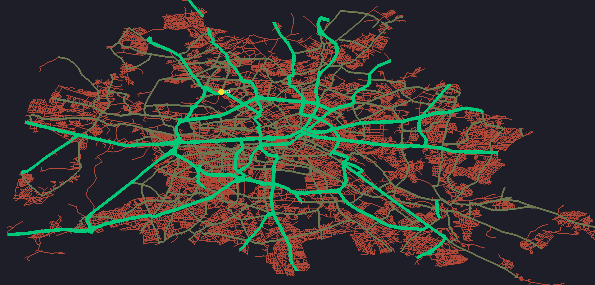
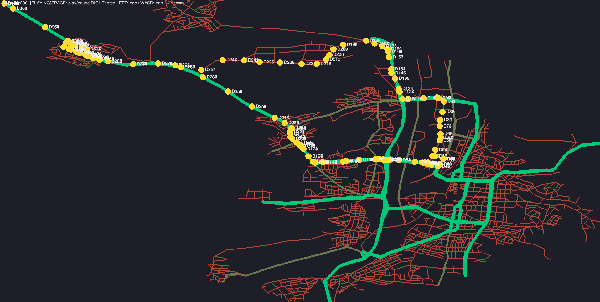
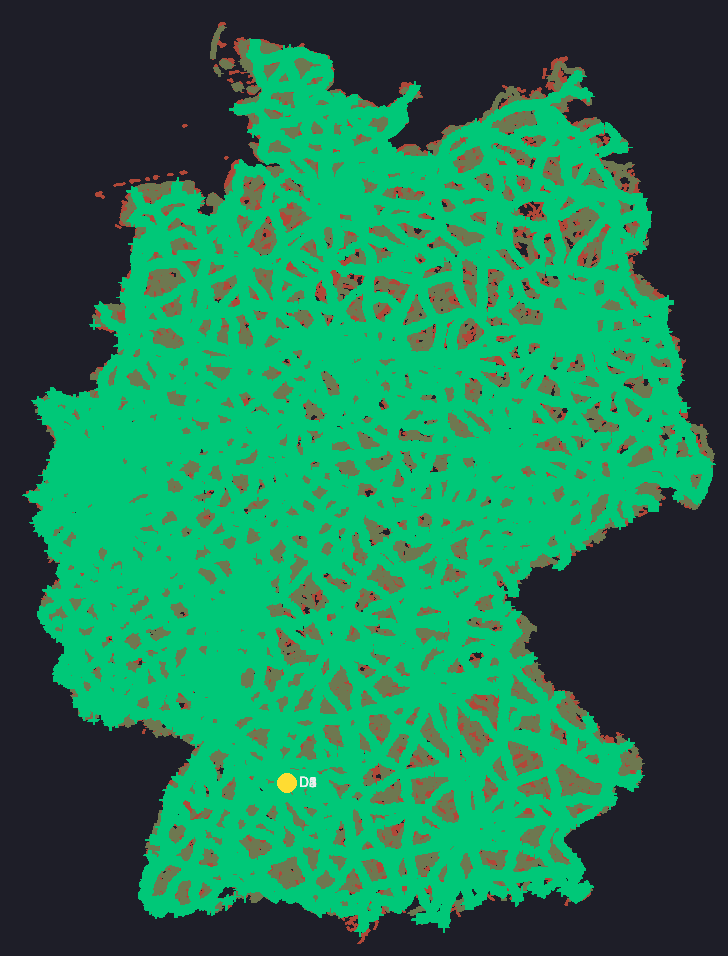

*This project has been created as part
of the 42 curriculum by razmmer.*

# FlyIn
## Description
FlyIn is a multi-drone routing system designed to move a fleet of drones from a start hub to an end hub across a weighted graph network, in the fewest simulation turns possible. Each hub has a zone type (normal, restricted, priority, blocked) that affects movement cost and routing preference. Connections between hubs have capacity limits, and hubs themselves can restrict how many drones occupy them simultaneously.

The system plans collision-free flight paths for multiple drones through a hub-and-connection network using Cooperative Pathfinding. Each drone is planned one at a time, and once planned, its path is "locked in" so later drones route around it.
Hubs are nodes (start, end, waypoints), connected by links with capacities. Each hub has a zone type that affects movement cost and a max_drones limit.
Zone rules: normal = 1 turn to traverse, restricted = 2 turns, priority = 1 turn but preferred by the pathfinder's tie-breaking, blocked = impassable.
Each cell tracks how many drones have reserved that hub or link at that turn. When a cell hits its capacity, it's blocked for the next drone.

#### ALGORITHM

The core of each individual drone's routing is a time-space A* search. Unlike standard A*, the state is (hub, turn) rather than just hub — the same hub at different times is a different state. This lets drones yield, wait, and route around time-based conflicts.

A* was chosen because the graph has weighted edges (restricted zones cost 2 turns, priority zones are preferred) and a clear goal state, making it a natural fit over simpler approaches like BFS which treat all edges equally.

At each state (hub, turn), the drone can either wait (if the hub has capacity at turn+1) or move to any non-blocked neighbour (if the link and destination hub both have capacity at the relevant turns). Priority-zone neighbours get a small bonus=0 tie-break advantage over bonus=1 for normal zones, so equal-cost paths prefer them. Additionally, waiting also has a tie-break bonus over moving to avoid drones moving back and forth between two hubs instead of waiting for two turns.
plan_all_drones wraps the above in a simple sequential loop:

This approach is optimal for each individual drone given the constraints of those planned before it, but not globally optimal across all drones simultaneously, since earlier drones get better paths and later drones may need to wait or detour.

Fun Fact: Technically, the ithm is perfectly capable of having drones use multiple start and end positions. However, a slight rework of he visualizer would be needed to make this work (since the visualizer relies on knowing that all drones start from the provided start hub)
#### VISUALS
The visualizer comes with many incredible features!

User input:
- WASD controls
- Zoom using +/-
- Show / hide hubs using h key
- Pause / Resume playback using space
- Use left / right arrow keys to move steps manually when paused

Neat details:
- Connections with higher capacity are more WIDE
- Additonally, connections with higher capacity are more GREEN, while ones with lower capacity are more RED
- Start and end hubs have nice little marking rings around them
- Hubs and drones are labeled, of course!
- A minimalistic loading screen will accompany you for a while if you decide to load mind-bogglingly huge maps.
- In the top left corner of the visualizer useful informations like the current turn, total turns and controls are displayed

Examples:

The city of Berlin

1000 drones on their way to 42 Heilbronn

Map of the entire road network of germany (1.4GB large text file (do not load if you want to keep your PC))

## Instructions
To launch the project, type

**python3 main.py**

or just ./main.py

Congratulations! If everything worked correctly you will now be prompted to enter the name of the text file that you want to use to read the map.
As an example:

Enter name of file to read map data from: **yourtextfilenamehere.txt**

Fun Fact: For quality of life improvement, the program will also accept an input where ".txt" is omitted, by automatically checking
for the possiblity of you being lazy if the first open attempt is unsuccessfull

Depending on the size of your map and the number of drones, it can take a while until the visualizer launches. Dont be afraid, the terminal will tell you how many drones have already finished pathfinding

*Warning: waiting times for individual may increase by a lot when trying to pathfind trough more complex maps (a map of Luxembourgh has been successfully traveserd before though, just bring some patience, or smaller maps <3). Also, individual drones waiting times may get larger for later drones, since the fastest paths to the goal are getting gradually more blocked off by their ancestors.*

Once this step is completed the visualizer will launch. As this happens, the instructions of the drones will be saved to "output.txt" for easy access (one line per turn as also seen in the subject)

*Visualizer loading time estimate:*
*Most maps take fractions of a second to load*
*Cyprus takes about 1½ minutes to load*

Now you should 

## Resources

Conflict based search:
https://www.youtube.com/watch?v=UeZR3IzVbwM&t=34s
https://www.youtube.com/watch?v=FnrZyL6965o
https://www.youtube.com/watch?v=UeZR3IzVbwM
A Star:
https://www.youtube.com/watch?v=71CEj4gKDnE
https://www.youtube.com/watch?v=-L-WgKMFuhE
Dijkstras Algorithm
https://www.youtube.com/watch?v=bZkzH5x0SKU
https://www.youtube.com/watch?v=GazC3A4OQTE
MAPF in general:
https://en.wikipedia.org/wiki/Multi-agent_pathfinding

#### AI USAGE
AI was used during the project to assist with debugging, help weighing 
off benefits of different algorithm and MAPF approahes and for generating
diagrams for the ReadMe.md